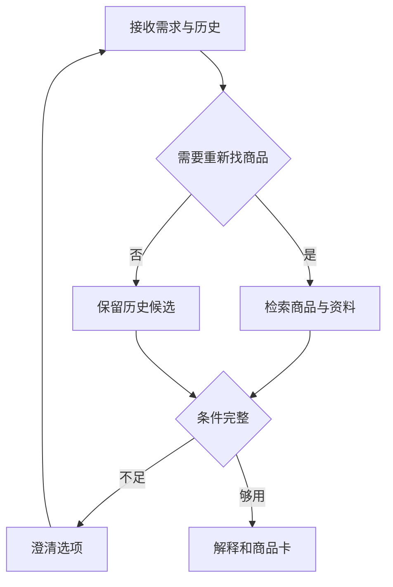

# 球球 技术架构与接口边界

源码核对基线：`825f047f81b54195e246ea4b14dfb2b5ff180d8d`。

- 客户端：`client/android/` 下 Kotlin Android 工程；会话交互、商品详情与 `CartStore.kt`。
- 服务：`server/api/routes/chat.py` 提供聊天入口，`server/agent/orchestrator.py` 处理路由、澄清和 SSE，`server/rag/retriever.py` 处理召回与排序。
- 数据：商品 ID 关联商品主数据与 FAQ/评价。前置硬约束与结构化会话一致性属于后续验证项，本地购物车不等于支付。

| 交接 | 产品契约 |
|---|---|
| Android → API | 会话、当次输入及可用上下文 |
| 召回 → 生成 | 候选商品 ID、结构字段、可用证据 |
| SSE → Android | 文本及结构化卡片/澄清事件；事件标签看代码 |
| 详情 → 本地购物车 | 选定的商品 ID、规格与数量，价格来自商品数据 |

## v1.2 商品约束检索

在普通检索路径中，服务端从当前输入提取明确预算上限，结合品类和排除词构造 Chroma 商品元数据过滤条件。检索缓存包含约束条件。返回前复查价格区间最高价和排除词，少于五项时，以相同约束扩大候选池一次，再按商品 ID 去重。仅保留最终候选对应的证据片段。
