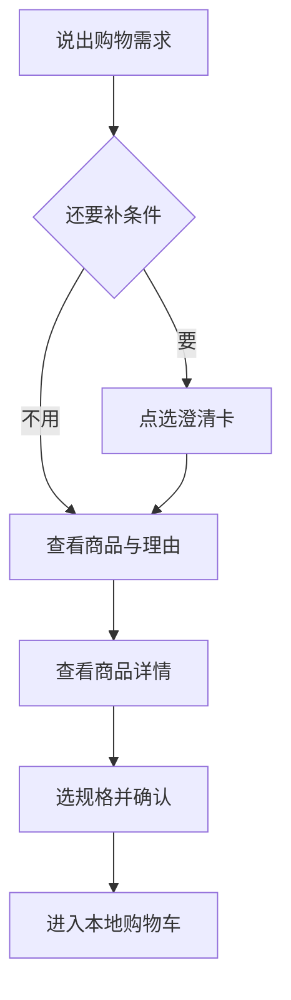
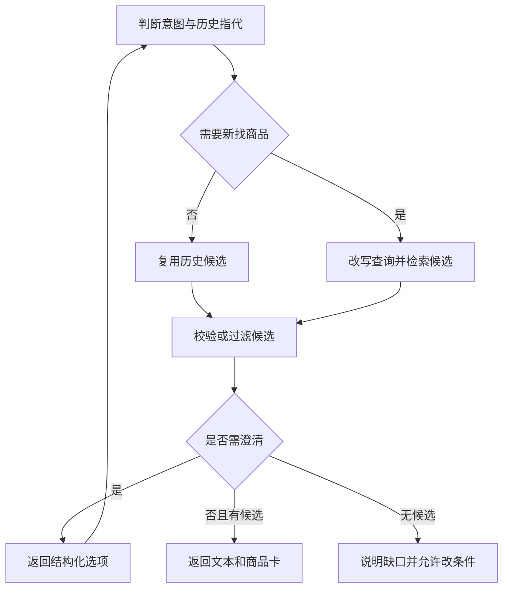
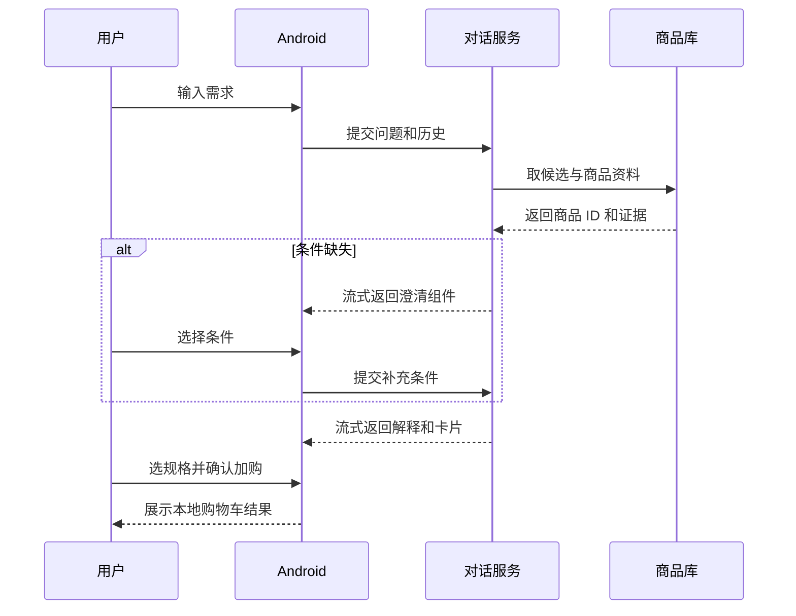

# 球球 RAG 智能导购 PRD

**版本 v1.1 · 2026-6-19 **

[交互原型 · Android 核心流程](https://www.figma.com/design/VIk4IyS8BLG0YSm3lpXi3R?node-id=9-29) · [验收用例](acceptance.csv)

## 1. 需求背景与目标

用户可能知道想要「预算内、适合自己」的商品，却不知道准确品名或筛选词。常规搜索需要自己拆条件、逐页比较。首版帮助用户把需求说清楚、拿到可核对的商品候选，并在确认规格后加入本地购物车。真实转化与留存待有用户数据再评估。

本期是导购和本地购物车，原型中的结算为模拟。实时交易、长期记忆、严格前置成分约束与补召回属于后续范围。

## 2. 现有流程、用户故事与 Agent 故事

| 故事 | 说明 |
|---|---|
| 用户故事 Q02 | 作为还没确定预算和肤质要求的购物者，我想用一句话开始，并通过少量选项明确条件。已经说过的预算应保留。 |
| Agent 故事 Q02/Q03 | 作为导购助手，我需要当前问题、会话上下文和已召回候选，判断是否宽泛、是否换货或追问已有商品；依靠商品检索和证据片段解释推荐。 |
| 工具与边界 | 商品主表支持检索和规格展示，FAQ 或评价片段提供说明。模型负责解释；价格、商品 ID、SKU 来自商品数据。实际加购用客户端状态。 |
| 输出与人工入口 | 返回文本，以及适用时的澄清选项或商品卡。卡片不可用或无匹配时说明原因；用户需要明确选择规格、确认加购。 |

## 3. 用户旅程与 Agent 工作流

**用户旅程（前台）。** 这里的图画用户能看到和操作的内容。



**Agent 工作流（后台）。** 现有代码可核对的澄清触发包括首轮、候选至少三项、且命中宽泛查询条件。它是当前规则，不保证所有该追问题都正确触发。



**关键时序 Q02/Q06/Q07。** 图中事件名称是产品层表达，不当成接口字段。



## 4. 原型和 GUI in LUI

| 原型画板 | 对话里为什么插 GUI | 要验什么 |
|---|---|---|
| 欢迎／澄清 | 把肤质、预算等关键条件变成可点击选项，降低来回打字成本 | 保留已选值；选完作为下一轮输入；条件已明确时少打断 |
| 推荐／对比 | 用卡片显示结构化商品事实，文本用来解释差异 | 正文商品、卡片与详情 ID 一致；长消息和商品图完整可见 |
| 详情／购物车 | 在详情选 SKU，再由本地逻辑更新购物车 | 对应选中规格、数量和价格；模拟结算有明确标识 |

Figwright 修复后已回读长回复的原生文本和容器尺寸。这属于设计稿验证。

## 5. 功能框架与版本范围

| 编号 | 能力 | 版本 |
|---|---|---|
| Q01–Q04 | 流式对话、需求收敛、检索与证据、多轮指代 | MVP |
| Q05–Q08 | 比较评价、商品卡及详情、本地购物车、语音入口 | 按现有代码与原追踪表分别核对 |
| Q09–Q10 | 硬约束过滤与补召回、进一步的一致性保障等 | 后续方案，待验 |

## 6. 详细规则与验收

| 需求 | 触发 | 行为与失败处理 | 验收 |
|---|---|---|---|
| Q01 | 流式输出中网络断开 | 预期标记为未完成并可重试；复核旧回复是否串到新请求 | Q01-TC02，运行待验 |
| Q02 | 输入“推荐一款精华” | 确认是否走澄清，点选后应反映在后续查询 | Q02-TC01，运行待验 |
| Q02 | 输入“预算500元，推荐精华” | 验收时确认保留 500 元上限，避免重复追问预算 | Q02-TC02，运行待验 |
| Q03/Q06 | 无可用商品，或文本、卡片不一致 | 说明无匹配；核对中间商品 ID、SSE 事件和 Android 渲染，不能生成库外商品或价格 | Q03-TC02 与 Q06 用例 |
| Q07/Q09 | 规格未选或用户给出排除条件 | 规格确认由客户端处理。现有代码可见后置排除过滤；拟评估前置结构化排除，属性未知单独处理 | Q07 / Q09 用例 |

## 7. Prompt 规格与输出约束

**示例节点：对话路由和澄清。** 以下为复盘规格，用于设计验收。现有 Prompt 和输出标签以仓库为准。

- 角色：帮助用户收敛需求的导购助手。
- 难点：别名、已有候选指代、预算上限和否定表达。
- 规则：优先利用已给条件。确需追问才给少量选项。商品事实来自检索结果。
- 输出控制：条件、路由和用户可见话术可按字段校验。后端组装展示卡片；模型不负责生成真实 SKU 价格。
- Few-shot：有预算而缺肤质时保留预算，可问肤质。若只问「上一款有多大规格」则优先沿用上一轮商品；无法定位时先确认。

```json
{"route":"clarify","constraints":{"category":"精华","budget_max":500},"questions":["你更在意肤质适配还是主要功效？"]}
```

## 8. 评测集和四层指标

| 层 | 口径 | 当前状态 |
|---|---|---|
| 业务 | 详情到加购转化 = 加购会话 ÷ 有详情曝光且可加购的会话 | 需真实使用数据 |
| 端到端 | 答复与卡片一致 = 正文商品与卡片 ID 一致的卡片用例 ÷ 有卡片的有效用例 | 候选目标 95%，未实测 |
| 过程 | 单目标 Hit@3 = 目标商品在前三的案例 ÷ 单目标检索案例；硬约束、多轮与兜底分别统计 | Hit@3 候选目标 85%，未实测 |
| 护栏 | 首内容和完整回复 P95、推理成本、错误 SKU 加购 | 错误 SKU 逐例阻断，基线待跑 |

240 条合成用例（开发 80、留出 160），覆盖商品定位、证据、多轮、约束和异常。固定商品库快照，用规则检查 ID、格式和约束，对有依据的推荐理由做人工抽检。离线成绩需要执行、留结果后再填写。

## 9. 非功能性需求

以会话和请求标识区分流式响应与重试，异常有可见状态。记录路由、首内容与完成耗时、卡片 ID 一致性结果，避免收集不必要的身份和会话数据。商品价格和 SKU 从商品数据读取，加购只影响本地购物车，错误 SKU 不进入后续流程。上线门槛需在实跑和影响评估后决定。
