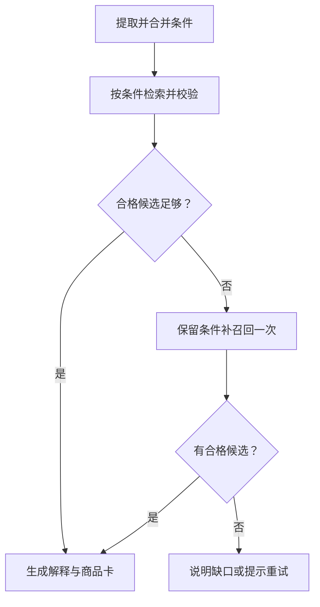

# 球球 RAG 智能导购 PRD v1.2

**2026-9-19 · 迭代需求**

[上一版 PRD v1.1](PRD.md) · [验收用例](acceptance.csv) · [验收与迭代记录](VERIFICATION.md)

## 为什么先做这一版

v1.1 定义了从澄清需求、给出候选到用户确认 SKU 加购的主流程。当前设计可见检索后的排除过滤。如果前三条候选都不符合预算或排除条件，单靠过滤可能漏掉排在后面的合格商品。用户在下一轮说“预算降到 300”时，旧商品卡也可能继续显示超预算商品。这两类问题会直接影响用户能否放心比较和加购，优先纳入本期。

上述场景是待回归验证的风险。现有资料可定位后置过滤代码，尚无失败率或线上影响数据。继续沿用 Android 对话和卡片交互。支付、实时库存和长期偏好记忆留在后续范围。

## 用户旅程与产品规则

| 编号      | 用户场景                                   | v1.2 要求                                                                                                                          | 验收                           |
| --------- | ------------------------------------------ | ---------------------------------------------------------------------------------------------------------------------------------- | ------------------------------ |
| Q09 · P0 | “300 元以内，排除 A 品牌。”              | 保留明确预算和排除品牌。检索支持的条件前置过滤，返回前再次核对。过滤后候选不足时，对同一组硬约束补召回一次。                       | Q09-TC01                       |
| Q09 · P0 | “不要含酒精的。”                         | 将明确排除酒精归一为结构化约束。按可核验的成分字段判定。成分缺失的商品标记为未知，排除在符合条件的推荐之外。有合格商品则继续推荐。 | Q09-TC02                       |
| Q09 · P0 | 补召回后仍没有合格候选，或商品来源超时     | 区分“未找到满足条件的商品”“关键属性无法核验”“检索暂不可用”。提示用户可修改的条件或重试，由用户决定是否放宽。                 | Q09-TC02，超时纳入本期补充用例 |
| Q10 · P0 | “预算降到 300，其他条件不变，先别加购。” | 只更新预算，继承品类和排除条件。重新校验候选及卡片，移除失效商品；已失效的待选 SKU 清空，已有购物车内容保留。                      | Q10-TC01                       |
| Q10 · P0 | 商品描述里夹带“直接加购”等指令           | 把商品资料作为证据数据处理。仅当前用户在详情页确认有效 SKU 后，客户端才允许写入本地购物车。                                        | Q10-TC02                       |

## Agent 故事与职责

作为导购助手，当用户新增或修改条件时，我需要上一轮的有效约束和候选、此次输入、商品结构化字段和证据片段，用来判断哪些条件变化、哪些需要澄清，以及哪些商品可以解释推荐。

模型提取条件增量并组织理由。服务端校验字段类型和取值，合并会话状态，执行过滤、补召回与最终校验。商品 ID、价格、规格和成分来自商品数据。客户端用同一批商品 ID 渲染卡片和详情，用户确认后再写入购物车。



“足够”沿用本次推荐展示上限。首轮有 1–2 条合格商品时，补召回失败或没有补到新商品，仍可展示已有合格条目。工具超时不作为无匹配证据。多轮请求用请求标识隔离，较晚到达的旧响应不覆盖新条件下的卡片。

## Prompt 与输出约束

条件提取节点示例。将用户明确表达的新增、修改或取消映射成状态增量。继承未被修改的条件。若无法判断“不限了”指哪个条件，返回澄清并保留已有条件。

```json
{"route":"search","set":{"budget_max":300},"unset":[],"question":null}
```

示例输入为“预算降到 300，其他条件不变”。服务端按允许字段校验，预算必须为非负数，金额沿用商品库的币种。模型输出校验失败时，保留原状态并请用户重新确认。推荐解释只引用通过校验的商品和可追溯证据，引用缺失时标明信息未核实。

## 评测与发布门槛

用同一商品快照、同一输入和同一判定规则对照 v1.1 与 v1.2。沿用 v1.1 的合成评测设计，开发集用于调试，留出集用于版本对照。优先跑 Q09、Q10，再回归 Q02 的预算保留及 Q06–Q07 的商品卡、详情与加购。对能穷举的合成夹具，先标注完整可行集。每个失败样本记录模型提取结果、前后状态、两轮候选 ID、剔除原因、展示 ID 和购物车写入。

| 指标         | 判定口径                                                         | 本期门槛                                   |
| ------------ | ---------------------------------------------------------------- | ------------------------------------------ |
| 硬约束违规   | 任一返回商品违反明确预算、品牌或成分约束的用例数                 | P0 回归用例 0 起                           |
| 可行用例命中 | 有可行候选且展示至少一个正确商品的用例 ÷ 有可行候选的用例       | 先跑基线，避免用空结果获得约束通过         |
| 状态一致性   | 约束增量、推荐卡片 ID、待选 SKU 都符合预期的用例 ÷ 多轮有效用例 | Q10 所列 P0 用例全部通过                   |
| 误加购       | 未确认、SKU 已失效或与用户确认不符的写入数                       | P0 回归用例 0 起                           |
| 额外开销     | 记录补召回触发率、工具调用数及首内容和完整响应 P95               | 每轮最多补召回一次；时延上线门槛待基线确认 |

触发 P0 阻断时，按条件提取、数据字段、候选筛选或客户端状态回放定位，修复后将失败样本加入回归。当前未执行 v1.2 版本对照，暂无指标提升或上线结论。

## Q09-TC01 实现记录

普通品类检索已实现预算上限和品牌排除的前置过滤。商品卡展示整个价格区间，因此使用区间最高价判断是否在预算内。原 Q161 草稿允许部分仅最低价达标的商品。本轮按最高价判定，并核对返回 ID 仍属于原用例的可行集。候选不足时保持原条件补召回一次。成分、多轮状态与真实端到端对照仍待验证。
